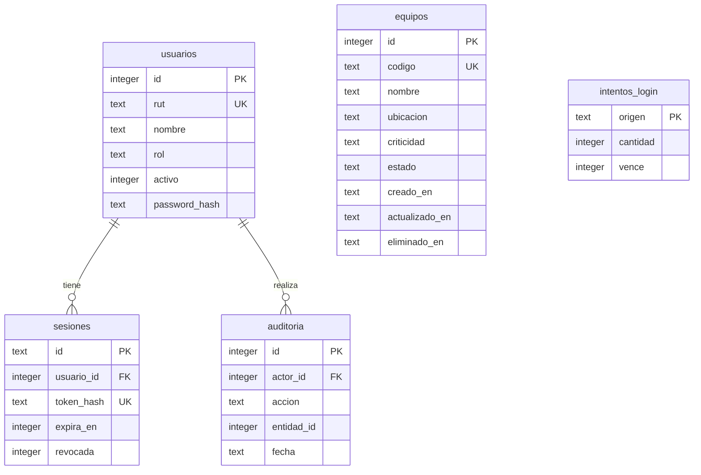

# Modelo de datos implementado

SQLite con foreign_keys=ON, transacciones en escrituras de equipos y consultas parametrizadas.

eliminado_en nulo significa equipo consultable; con fecha significa baja lógica. La unicidad del código abarca ambas situaciones. entidad_id en auditoría identifica al equipo afectado y no es una FK genérica; los eventos de autenticación usan entidad nula. actor_id puede ser nulo en intentos rechazados. No se almacena contraseña ni token legible en auditoría.
