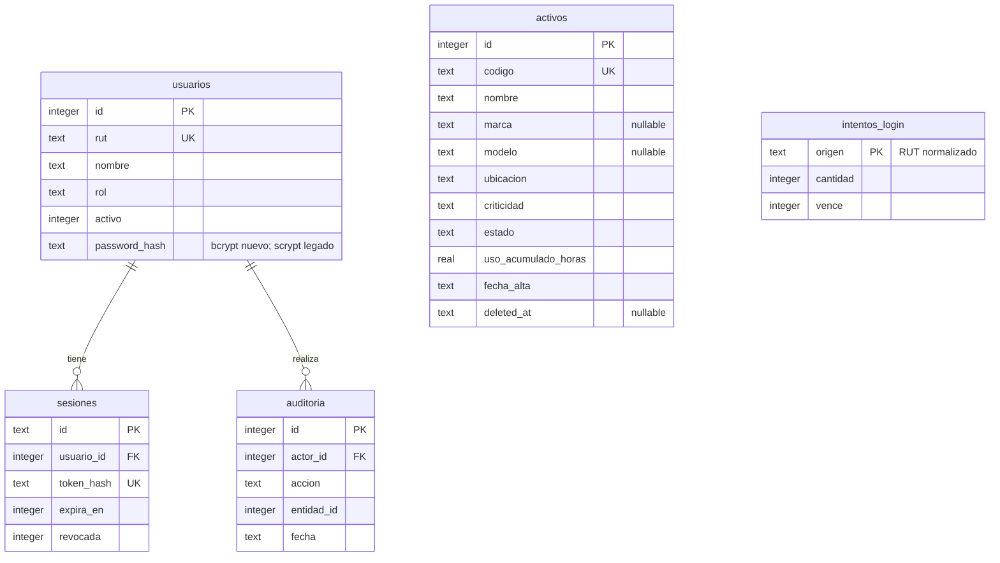

# Modelo de datos de HU-01 y HU-02

SQLite usa better-sqlite3 mediante db.ts y conserva usuarios, sesiones y activos existentes. El archivo por defecto es backend/data/app.db; DB_PATH permite abrir backend/data/andina.sqlite para mantener la base anterior. foreign_keys=ON, escrituras y auditoría transaccionales, consultas parametrizadas.

## Autenticación y compatibilidad

Las contraseñas nuevas se guardan con bcrypt de coste 12. Los hashes scrypt existentes siguen verificándose; un login correcto con contraseña de hasta 72 bytes reemplaza ese hash por bcrypt. Contraseñas heredadas mayores conservan el hash scrypt para evitar truncamiento.

Sesiones conserva id, usuario_id, token_hash, expira_en y revocada. jsonwebtoken firma JWT HS256 de ocho horas; token_hash sigue siendo SHA-256. Logout marca la sesión revocada y deja de aceptar ese token. El rol y activo se comprueban contra el usuario vigente.

intentos_login conserva sus columnas; origen representa ahora un RUT normalizado, no una IP. cantidad y vence registran los fallos de ese RUT en la ventana de cinco minutos. Cinco fallos reciben 401; el intento siguiente recibe 429 hasta que venza la ventana. Reiniciar no borra el contador y otro RUT es independiente.

seed() crea el SUPERVISOR DEMO 11111111-1/admin123 únicamente si no existe. Repetir seed no cambia contraseña, rol ni otros campos de un usuario existente. El servidor lo invoca al arrancar; el CLI admite SEED_* opcionales para crear otros usuarios.

## Reglas de activos

- deleted_at nulo significa activo consultable; con fecha significa baja lógica y estado FUERA_DE_SERVICIO. La unicidad de codigo abarca ambas situaciones.
- En creación: estado OPERATIVO, uso_acumulado_horas 0 y fecha_alta del servidor. Marca/modelo opcionales parten en null.
- PATCH solo cambia campos presentes permitidos; no cambia codigo, estado, fecha_alta ni deleted_at. Uso acumulado debe ser no negativo; null permite vaciar marca/modelo.
- No se implementa una máquina de estados de OT/intervenciones.

entidad_id en auditoría identifica al activo afectado y no es una FK genérica. Autenticación usa entidad nula; actor_id puede ser nulo en intentos rechazados. No se guardan contraseñas ni tokens legibles en auditoría.

## Migración desde equipos

La migración transaccional copia una sola vez los registros de la tabla anterior equipos a activos, preservando id, codigo, nombre, ubicacion, criticidad, fechas y bajas. creado_en pasa a fecha_alta y eliminado_en a deleted_at; las bajas se copian con estado FUERA_DE_SERVICIO. Marca/modelo se inicializan en null y uso_acumulado_horas en 0. Conservar IDs mantiene la referencia lógica de la auditoría histórica.

La tabla equipos permanece como legado; las rutas trabajan únicamente con activos. Un registro de migración impide volver a importar la copia histórica al reiniciar. No se eliminan filas de ninguna tabla de activos como parte de la baja.
